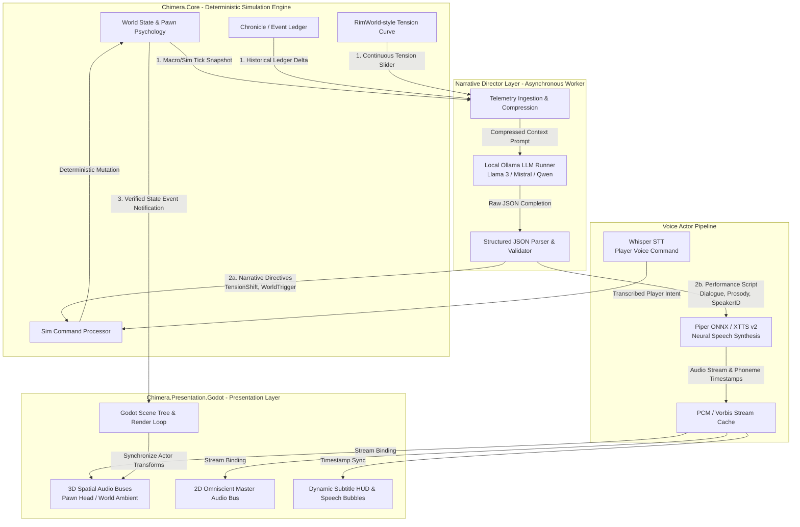

# Narrative Director & Voice Pipeline Architecture

## 1. Executive Summary & Architectural Question Resolution

### The User's Question
> *"I assume that layer talks only to the sim, and the sim talks to the game? Or maybe both at once? We will discuss in that other chat."*

### Architectural Resolution: The Decoupled Triad (Model-Director-View)
Neither a strictly linear pipe (`Director -> Sim -> Godot`) nor an unmediated bypass (`Director -> Godot` bypassing the Sim) is sufficient on its own. 

1. **Why Pure Linear (`Director -> Sim -> Godot`) Fails:**
   - `Chimera.Core` must remain a 100% deterministic, headless C# library with **zero dependencies on audio libraries, GPU/neural runtimes, or Godot scene nodes**.
   - If `Chimera.Core` had to ingest, store, or stream raw PCM/WAV audio buffers or Piper/XTTS waveforms, it would bloat the simulation memory footprint and introduce audio playback concerns into the deterministic state ledger.
2. **Why Direct Bypass (`Director -> Godot`) Fails:**
   - If the LLM directly modified Godot entities without the simulation's knowledge, the world state would de-synchronize. Spoken actions, mental breaks, or weather shifts would exist only as cosmetic hallucinations without physical or psychological consequences in `Chimera.Core`.
3. **The Solution: Triad Contract (Command-Query / Event-Ledger Pattern)**
   - **Simulation (`Chimera.Core`) is the Ground Truth Authority:** Exposes read-only telemetry digests (tension levels, pawn emotional trauma, historical event ledgers) and accepts validated intent commands (`INarrativeDirective`).
   - **Narrative Director (`Ollama / LLM`) is an Asynchronous Intelligent Co-Processor:** Analyzes simulation telemetry out-of-band, determines dramatic beats, and issues two distinct streams:
     1. **Simulation Directives (State Intent):** Sent to `Chimera.Core` (e.g. increase ambient tension, queue a bandit raid, trigger an emotional breakdown).
     2. **Performance Scripts (Dialogue & Narration):** Sent to the Voice Pipeline with emotional tags and prosody cues.
   - **Voice Actor Pipeline (`Piper / XTTS`) is a Presentation Asset Producer:** Synthesizes audio waveforms from performance scripts off the main thread.
   - **Godot Layer (`Chimera.Presentation.Godot`) is the Media & Spatial Sink:** Subscribes to verified simulation events from `Chimera.Core` and receives synthesized audio streams from the voice pipeline, binding them to 3D spatial audio buses, subtitle HUDs, and pawn speech animations.

---

## 2. System Architecture & Information Flow



---

## 3. Communication Contracts & Data Schemas

### 3.1 Sim-to-Director Telemetry Digest (`SimTelemetrySnapshot`)
Sent periodically (e.g. every macro-tick or upon high-severity events) from `Chimera.Core` to the Narrative Director.

```json
{
  "tick": 142300,
  "in_game_time": "Year 124, Autumn, Day 14, 21:40",
  "world_tensions": {
    "aggregate_tension_slider": 0.72,
    "current_arc": "GatheringStorm",
    "threat_points_budget": 350.0,
    "last_major_incident_tick": 128000
  },
  "focal_pawns": [
    {
      "pawn_id": "pawn_kael_01",
      "name": "Kael",
      "species_slider": 0.15,
      "health_status": "SevereHypothermia",
      "current_mood_slider": 0.18,
      "dominant_thoughts": ["Starving", "FriendDiedRecently", "Darkness"],
      "mental_break_imminent": true,
      "break_threshold": 0.20
    }
  ],
  "environmental_hazards": {
    "ambient_temperature_k": 262.15,
    "weather_intensity_slider": 0.85,
    "bioluminescence_level": 0.05
  },
  "recent_ledger_events": [
    "Kael witnessed the death of Silas (tick 141900)",
    "Ration stores depleted below 3-day reserve (tick 142100)"
  ]
}
```

### 3.2 Director-to-Sim Contract: Narrative Directives (`INarrativeDirective`)
The Ollama LLM outputs strict JSON matching the grammar defined in `Chimera.Core.Director`.

```json
{
  "director_intent": {
    "narrative_beat": "ClimacticBreakdown",
    "target_tension_delta": 0.15,
    "scheduled_sim_events": [
      {
        "event_type": "MentalBreakTrigger",
        "target_entity_id": "pawn_kael_01",
        "break_type": "BerserkOrCatatonic",
        "delay_ticks": 40
      },
      {
        "event_type": "WeatherShift",
        "parameter_key": "blizzard_intensity",
        "slider_target": 0.95,
        "transition_duration_ticks": 600
      }
    ]
  },
  "performance_payload": {
    "narration_segment": {
      "speaker_role": "OmniscientNarrator",
      "voice_profile": "dark_poetic_narrator",
      "text": "The bitter frost gnaws at Kael's trembling hands. In the dark, memory cuts sharper than the wind.",
      "emotion": "melancholic",
      "speech_rate": 0.92,
      "pitch_scale": 0.95
    },
    "pawn_dialogue": {
      "speaker_id": "pawn_kael_01",
      "voice_profile": "kael_exhausted",
      "text": "Silas... why didn't you run?",
      "emotion": "despairing",
      "speech_rate": 0.85,
      "spatial_3d": true
    }
  }
}
```

---

## 4. Voice Synthesis & Audio Streaming Pipeline

### 4.1 Piper vs. XTTS v2 Allocation
- **Piper (Fast Local Neural TTS):**
  - **Latency:** ~50–150ms per sentence on modern CPUs/GPUs.
  - **Usage:** Dynamic pawn dialogue, battle shouts, environmental whispers, high-frequency gameplay responses.
  - **Packaging:** ONNX runtime integrated into a background worker service (`Chimera.AudioService`).
- **XTTS v2 (High-Fidelity Expressive Voice Cloning):**
  - **Latency:** ~600ms–1500ms.
  - **Usage:** Cinematic omniscient narration, introductory world chronicle readings, deep emotional monologues during mental break climaxes.

### 4.2 Presentation & Spatialization in Godot (`Chimera.Presentation.Godot`)
1. **Audio Streams:**
   - Spoken dialogue returns an audio buffer (WAV/OGG or raw PCM stream) accompanied by timestamped word/phoneme boundaries.
   - Godot receives the stream via thread-safe queue and binds it to an `AudioStreamPlayer3D` attached to the pawn's bone/head position, or `AudioStreamPlayer` (2D) for the narrator.
2. **Audio Buses:**
   - `Bus: Master/Narrator`: Clean compression, subtle cinematic reverb.
   - `Bus: World/Speech/Radio`: Environmental low-pass filtering, distance attenuation, and acoustic occlusion based on surrounding voxel density.
3. **Subtitle & Speech Bubbles:**
   - Word timestamps trigger dynamic typewriter subtitles and in-world floating speech bubbles aligned with the audio duration.

---

## 5. Whisper STT (Player Input) Integration
When voice commands or player speech are enabled:
1. Godot captures player mic input as PCM audio.
2. Sent to local `Whisper.cpp` / ONNX STT model.
3. Transcribed text is parsed as a player intent:
   - If tactical/in-game command: sent directly to `Chimera.Core` player action queue.
   - If narrative inquiry/roleplay dialogue: injected into the Narrative Director's conversation memory for response generation.

---

## 6. Implementation Namespace Structure

Following the PRD standards:

```text
src/
├── Chimera.Core/
│   └── Director/
│       ├── INarrativeDirective.cs       // JSON contract interfaces
│       ├── SimTelemetrySnapshot.cs      // Structured state digest models
│       ├── TensionCurveModel.cs         // Storyteller pacing math
│       └── NarrativeEventSink.cs        // Receives and validates Director directives
│
├── Chimera.Narrative/ (Standalone service / library)
│   ├── OllamaClient.cs                  // Local Ollama REST / streaming client
│   ├── PromptTemplates.cs               // Dynamic prompt construction from PRD & Ledgers
│   └── DirectorOrchestrator.cs          // Telemetry poll -> LLM generate -> Split Directives & Audio
│
├── Chimera.Voice/
│   ├── PiperSynthesizer.cs              // Piper ONNX TTS wrapper
│   ├── XttsSynthesizer.cs               // XTTS client/runner
│   ├── WhisperTranscriber.cs            // Whisper STT runner
│   └── VoiceModelRegistry.cs            // Voice profiles (Narrator, Pawn accents, Archetypes)
│
└── Chimera.Presentation.Godot/
    └── Audio/
        ├── SpatialVoiceManager.cs       // Godot AudioStreamPlayer3D pool & spatial binding
        ├── SubtitlePresenter.cs         // Subtitle HUD sync with TTS timestamps
        └── AcousticOcclusionRaycaster.cs// Voxel raycasting for speech sound dampening
```

---

## 7. Latency Mitigation & Determinism Invariants

1. **Determinism Preservation:**
   - The simulation never waits synchronously for Ollama or Piper. 
   - When a directive arrives from the Director, it is stamped with the *next available simulation tick* and executed deterministically. If the LLM takes 2 seconds to generate a raid description, the simulation ticks smoothly in the meantime.
2. **Pre-caching & Speculative Generation:**
   - When the tension slider crosses threshold milestones (e.g. `0.65`, `0.80`), the Narrative Director preemptively prompts Ollama in the background for candidate upcoming dramatic incidents.
3. **Graceful Fallbacks:**
   - If Ollama or TTS is disabled or experiencing high load, the system seamlessly falls back to procedural text templates (RimWorld-style mad-libs) and synthesized procedural barks without halting the game.
